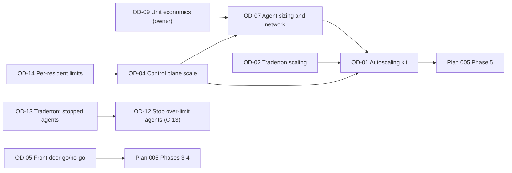

# 05 Open Decisions

**Status:** Draft v0.2
**Last reviewed:** 2026-11-11
**Purpose:** the backlog of decisions we know we must make, in dependency order, so that each is made once, with the right inputs, and nothing is decided by accident.

**Tier** is defined in [06-decision-method.md](./06-decision-method.md): T0 just decide, T1 short note, T2 brief and decision agent. **Owner input** marks a value judgment the evidence cannot supply.

## Backlog

| ID | Decision needed | Tier | Why now | Depends on | Blocks | Owner input | Brief |
|---|---|---|---|---|---|---|---|
| OD-09 | Unit-economics targets and spend ceilings (cost per resident agent, per active agent-hour, per browser session; monthly ceiling per tier) | T2 | Every cost trade-off needs a yardstick (strategy section 6) | none | OD-01, OD-07 | **Yes**: budget is a value judgment | not yet written |
| OD-14 | Per-resident control-plane limits: Postgres connections per agent (no pooler found), Redis clients, heartbeat rate, reminder polling. What to change and at what resident count | T2 | Likely the first wall, well below 10,000 agents (A-24). Found by the challenger of D-2026-001 | A-24 (verify with read-only checks first) | OD-04 | No | not yet written |
| OD-04 | Control-plane scalability at the envelope: single VM, single Nomad server, Postgres and Redis on the same host. HA Nomad quorum? Managed or dedicated DB? | T2 | P-01 review trigger fired (10,000 agents versus design envelope of 2,000+) | A-16, A-18, OD-14 | OD-07, OD-01 | No | not yet written |
| OD-12 | **Stop agents over their hard billing limit (C-13): mechanics.** Scope (all agents of a hard-limited account), grace period, notification, behaviour of trading agents with open positions, restart on top-up, what the meter does after stop | T2 | Owner decided C-13 on 2026-11-11; a plan must carry it | OD-13, P-08, INV-S1, INV-S2, A-22 | A capacity or lifecycle plan | Partly (grace period, user messaging) | not yet written; needs a plan |
| OD-13 | **Traderton:** what a trading agent's actor and running bots do when its container is stopped. Today stopping a session stops both (T-09) | T2 (Traderton-owned; no trading logic is decided in herobids, INV-L2) | C-13 would stop trading agents | T-09, P-08 | OD-12 | Traderton owner | not yet written |
| OD-07 | Agent-node sizing path and network topology: node sizes (cx23 to cx53), memory and CPU reservation, one or several private networks, quotas. Sized for the resident count (C-12) | T2 | About 700 small nodes is infeasible; sizes decide cost and network limits | A-05, A-08, A-09, A-23, OD-09, OD-04 | OD-01 | No | not yet written |
| OD-01 | Autoscaling architecture: scope of a shared kit for agent nodes, browser pool and Traderton; language; sequencing; adoption level per tier | T2 | Plan 005 Phase 5 is about to build a second autoscaler | C-07, A-19, A-21, OD-09 | Plan 005 Phase 5 | No | [briefs/001](./briefs/001-autoscaling-architecture.md) |
| OD-02 | Traderton scaling path: vertical first, API/worker split, cells with leases on a central database | T2 | 5,000 trading agents against per-IP venue limits | A-06, A-07, A-13, A-14, INV-S1, INV-L3 | OD-01 (adoption level for Traderton) | No | not yet written |
| OD-05 | Browser front door go or no-go, after the spike | T2 | Decides Option A or B (C-03) | Plan 005 spike S1 to S8 (A-15) | Plan 005 Phases 3 and 4 | No | after the spike |
| OD-06 | Browser pool authentication and session isolation | T2 | Without a token, any container on the network may list or attach to other sessions (unverified) | INV-X2, Plan 005 Phase 6 | Plan 005 Phase 6 | Partly (security stance) | not yet written |
| OD-10 | Terraform layout for the browser tier: separate root module and state, or the main state | T1 | Affects autoscaler allowlists and drift handling | OD-01 | Plan 005 Phase 4 | No | covered in Plan 005 |
| OD-08 | Single browser session timeout (Browserless 60 s versus 180 s in config) | T1 | Draining needs one number | Plan 005 Phase 1 results | Plan 005 Phase 5b | No | |
| OD-11 | Adopt the decision framework; host it here; mirror in Traderton | T1 | This folder | none | All of the above | **Yes** | this folder |

## Closed

| ID | Decision | Closed by | Date |
|---|---|---|---|
| OD-03 | Agent residency versus hibernation. **Decided: agents stay resident; hibernation is not implemented** | C-12, [D-2026-001](./records/D-2026-001-residency-vs-hibernation.md), [ADR-2026-11-019](../tech/architecture/adrs/2026/11/019-agents-stay-resident-no-hibernation.md) | 2026-11-11 |

## Suggested order

Reading the graph: OD-14 and OD-04 change how many nodes we can ever run, so they come before node sizing (OD-07) and before any decision about how to automate those nodes. OD-12 is independent of them and can start as soon as OD-13 has an answer, because it reduces the resident count rather than depending on it. OD-05 and OD-02 can proceed in parallel, because they are measurement-led. Plan 005 Phases 0 to 2 (baseline, measurement, stopgap move) need none of these and can start now.

## Rules for this file

1. Add a row when a decision is identified. Do not leave decisions implicit in a plan.
2. A decision leaves this file only when a Decision Record exists (or the owner has stated the decision and it is in the register `03`).
3. If a plan phase depends on an open decision, the plan says so and links the ID.
4. Never block safe, reversible, measurement-only work on an open decision.
