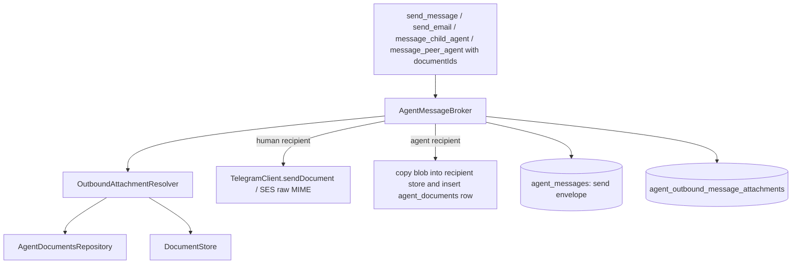

# Plan: Agent Outbound Message Attachments

> **Status (2026-11-24):** In progress. Not part of [two-way agent chat](../../../10/15/002-two-way-agent-chat/001-plan.md). Attachments attach to outbound message rows, not conversation message rows.

**Status:** in progress  
**Created:** 2026-07-13  

## Problem

Agents can send only text. No agent can send a document (PDF, DOCX, or text) to its user, to an external email address, or to another agent.

Current state:
- `send_message` accepts `subject`, `body`, `messageClass`, `emailDelivery`, `contextRef`. Telegram delivery uses `sendMessage` only.
- `send_email` accepts `to`, `cc`, `bcc`, `subject`, `body`, `fromConnectionId`. SES delivery uses `Content.Simple` only.
- `message_child_agent` accepts `agentId` and `message`. `message_peer_agent` accepts `agent` and `message`. Both are text only.
- Agents can read a stored document (`read_agent_document`) but cannot send one.

## Goal

An agent can attach documents it holds to any message it sends, to the same recipients it can already message. There is one mechanism: `documentIds`.

Example: an agent applying for a job sends the owner's CV (PDF) to the employer with `send_email`, and sends the owner a copy of the cover letter with `send_message`.

## Scope

### In scope

- `documentIds` on `send_message`, `send_email`, `message_child_agent`, and `message_peer_agent`
- Documents sent to a human arrive as attachments (Telegram `sendDocument`, email MIME)
- Documents sent to an agent are copied into that agent's store
- `list_agent_documents`, so an agent can find the documents it holds
- Audit of what was sent, to whom, and with what outcome

### Out of scope

- Agent-generated binary attachments from raw bytes
- Published artifacts as attachments
- New recipient rules. Each tool keeps its current rules for who it can reach.
- Web chat attachment delivery (not verified in code; see Open Questions)
- Multi-part upload from the agent runtime

## Product Decisions

### D1: One mechanism: `documentIds` on every tool that sends a message

Each tool that sends a message to someone also accepts `documentIds?: string[]` (max 3). The tool's recipient rules do not change.

| Tool | Recipient (unchanged) | What `documentIds` does |
|---|---|---|
| `send_message` | the user, or your creator while you run as a child | Telegram attachment to the user; a copy to a creator agent |
| `send_email` | any address `send_email` accepts today | MIME attachment in the email |
| `message_child_agent` | a direct child | a copy for the child |
| `message_peer_agent` | a peer agent of the same user | a copy for the peer |

The sender may attach only documents it holds: an `agent_documents` row with `agentId` equal to the sending agent, not deleted.

### D2: Humans receive bytes; agents receive a copy

- **Human recipient (Telegram, email):** the platform reads the bytes from the store and sends them. No agent keeps a copy.
- **Agent recipient:** the broker copies each blob into the recipient's store and inserts a new `agent_documents` row owned by the recipient, with `sourceDocumentId` pointing to the original. The copy is independent. Deleting the sender's document does not affect it. The delivered message lists the new document ids and filenames, so the recipient can call `read_agent_document` or `list_agent_documents`.

### D3: The platform controls delivery

The agent asks for attachments. The platform decides:
- each document exists, belongs to the sender, and is not deleted
- counts and sizes are within limits
- the channel is configured

Each attachment's outcome is returned to the sender and recorded in the audit trail. A failed attachment does not stop the text from being delivered.

### D4: Send the original file

Documents go out in their stored form: `.pdf` stays `.pdf` and `.docx` stays `.docx`. Extracted text companions are not sent.

### D5: Limits

- max 3 documents per message (existing store limit: 10 MiB per upload)
- max 5 MiB total per message before encoding, for every tool. SES `SendRawEmail` caps the whole message, including attachments, at 10 MB (AWS docs, checked 2026-11-24). Base64 adds about 33%, so 5 MiB of attachments fits with headroom.

## Current Implementation Constraints

### 1. Outbound tool inputs are text-only

- `SendMessagePayloadSchema` in `packages/domain/src/agent-protocol.ts` has `subject`, `body`, `contextRef`, `messageClass`, `emailDelivery`. No attachment field.
- `SendEmailParamsSchema` in `apps/worker/src/tools/email.ts` has no attachment field.
- `MessageChildParamsSchema` in `apps/worker/src/tools/agent-creation.ts` has no attachment field.
- `MessagePeerAgentParamsSchema` in `apps/worker/src/tools/peer-messaging.ts` has no attachment field. Its `PeerSendPayloadSchema` and `PeerMessagePayloadSchema` in `packages/domain/src/agent-protocol.ts` have none either.

### 2. Telegram adapter is `sendMessage`-only

File: `apps/worker/src/alerting/telegram-client.ts`

`TelegramClient` currently exposes:
- `sendAlert()`
- `sendText()`
- `setWebhook()`

It does not implement `sendDocument`.

### 3. Email adapter is `Simple`-content only

File: `apps/worker/src/alerting/ses-email-client.ts`

`SesEmailClient` currently uses `SendEmailCommand` with `Content.Simple`, which does not model file attachments.
A proper attachment flow will require raw MIME content.

### 4. Nothing resolves documents for outbound sends

`handleSendMessage()` in `apps/worker/src/agents/agent-message-broker.ts`:
- persists the outbound message row
- sends Telegram text if configured
- runs email fanout if allowed

It does not consult `AgentDocumentsRepository` or `DocumentStore`. The child and peer paths (`PEER_SEND` and `messageChildAgent`) have not been traced yet. They must resolve documents the same way, through the same resolver.

### 5. Outbound audit trail does not store attachment metadata

Existing outbound message persistence tracks delivery metadata, but not attachment references or copies.
A v1 needs a companion table.

### 6. Reading is text-only

`read_agent_document` reads the extracted text blob (`packages/documents/src/agent-document-read.ts`), with a 5 MiB text cap. A recipient agent receives the raw bytes in its store, and can send them on with `send_email` or `send_message`, but it reads a PDF as extracted text.

## Proposed Architecture



## Data Model

### Companion attachment table

`agent_outbound_message_attachments`:

```ts
agent_outbound_message_attachments {
  id: text pk,
  outboundMessageId: text not null,
  sourceDocumentId: text not null,         // sender's agent_documents.id
  recipientKind: 'telegram' | 'email' | 'agent' not null,
  recipientAgentId: text null,             // set when recipientKind = 'agent'
  copiedDocumentId: text null,             // recipient's new agent_documents.id
  filename: text not null,
  mimeType: text not null,
  sizeBytes: integer not null,
  deliveryStatus: 'pending' | 'sent' | 'failed' | 'skipped',
  deliveryRef: text | null,
  deliveryError: text | null,
  createdAt: timestamptz not null
}
```

Why a companion table:
- avoids overloading the `agent_messages` envelope row
- records each attachment's outcome separately
- records copies, so an agent can later trace where a document went

### `agent_documents` gains one column

`sourceDocumentId: text null`, set on a copy to the original document. It is null for uploads.

## Domain / Tool Contract

### Each sending tool gets one optional field

```ts
documentIds: z.array(z.string().min(1)).max(3).optional(),
```

| Tool | Schema to extend |
|---|---|
| `send_message` | `SendMessagePayloadSchema` (`packages/domain/src/agent-protocol.ts`), tool in `apps/worker/src/tools/messaging.ts` |
| `send_email` | `SendEmailParamsSchema` (`apps/worker/src/tools/email.ts`) |
| `message_child_agent` | `MessageChildParamsSchema` (`apps/worker/src/tools/agent-creation.ts`) |
| `message_peer_agent` | `MessagePeerAgentParamsSchema` (`apps/worker/src/tools/peer-messaging.ts`), `PeerSendPayloadSchema` and `PeerMessagePayloadSchema` (`packages/domain/src/agent-protocol.ts`) |

V1 behavior:
- omitted or empty: current behavior, unchanged
- present: the broker resolves the documents and delivers or copies them

Each tool description adds one sentence: `documentIds` takes up to 3 documents you hold (see `list_agent_documents`). A person receives them as attachments. An agent receives a copy.

### New tool: `list_agent_documents`

File: `apps/worker/src/tools/agent-documents.ts`, next to `read_agent_document`.

No parameters. Returns the agent's non-deleted documents: `documentId`, `filename`, `mimeType`, `sizeBytes`, `lifecycleState`, `sourceDocumentId` (set for copies).

Requires no new recipient rules. It lists only the caller's own documents.

## Delivery Adapters

### Telegram

File: `apps/worker/src/alerting/telegram-client.ts`

Add:

```ts
sendDocument(params: {
  chatId: string;
  filename: string;
  mimeType: string;
  body: Buffer;
  caption?: string;
  replyMarkup?: TelegramReplyMarkup;
}): Promise<Result<TelegramSendResult, { code: string; message: string }>>
```

Implementation notes:
- use Bot API `sendDocument`
- send multipart/form-data
- body becomes file payload
- caption should use the outbound text body or a shortened summary
- likely send text first, then each attachment, or use first attachment caption + follow-up text

Recommended v1 Telegram behavior:
- if attachments present, send the text body as the caption on the first document when possible
- if multiple attachments or caption length constraints apply, send the text body separately and attach documents after

### Email

Files:
- `apps/worker/src/alerting/email-client.ts`
- `apps/worker/src/alerting/ses-email-client.ts`

Extend the provider-neutral port:

```ts
interface EmailAttachment {
  filename: string;
  contentType: string;
  body: Buffer;
}

interface EmailMessage {
  to: string;
  subject: string;
  text: string;
  html?: string;
  attachments?: EmailAttachment[];
}
```

SES implementation notes:
- `send_email` recipients (`to`, `cc`, `bcc`) are unchanged. Attachments follow the same recipients, with no extra rule.
- switch from `Content.Simple` to raw MIME when attachments exist
- preserve current simple path for no-attachment emails
- generate `multipart/mixed` with text/plain and optional text/html alternatives

### Agent copy (new)

Used when the recipient is an agent: `message_child_agent`, `message_peer_agent`, or `send_message` routed to a creator.

For each resolved document:
1. read the blob from `DocumentStore` (sender's store key)
2. write it to `DocumentStore` under a new key for the recipient
3. insert an `agent_documents` row with `agentId` = recipient, same `userId`, `sourceDocumentId` = sender's document id, and the copy's own store keys

The recipient gets its own copy of the original bytes. The sender's later deletion does not affect it. Whether to reuse `AgentDocumentService` for the write, rather than duplicating its checks, is an implementation decision.

## Broker Flow

### `handleSendMessage()` and the other sending paths

Files: `apps/worker/src/agents/agent-message-broker.ts`, plus the peer and child paths once traced.

New flow:
1. load the sending agent and its active session, as today
2. persist the send's envelope row in `agent_messages` (keyed by `message_id`), as today; attachment rows reference it by `outboundMessageId`
3. if `documentIds` is present:
   - resolve each id via `AgentDocumentsRepository`
   - reject the request if a document is missing, belongs to another agent, or is deleted
   - enforce count (3) and total size (5 MiB)
   - read the blobs from `DocumentStore`
   - persist one pending attachment row per document, with its `recipientKind`
4. deliver by recipient:
   - human via Telegram: `sendDocument` per file
   - human via `send_email`: MIME `multipart/mixed` with the attachments
   - agent: create copies (see Agent copy) and list the new ids in the delivered message
5. update each attachment row to `sent` or `failed`. A failure on one attachment does not drop the text or the other attachments.

### Ownership rule

Recommended rule, for every tool:
- the sender may attach only documents with `agent_documents.agentId` equal to its own id, and not deleted
- documents the sender holds as copies count as its own

This matches the existing per-agent document scope, so no new recipient or sharing rule is added.

## Suggested Supporting Services

### `OutboundAttachmentResolver`

Recommended new worker service:

```ts
class OutboundAttachmentResolver {
  constructor(
    private readonly documentsRepo: AgentDocumentsRepository,
    private readonly documentStore: DocumentStore,
  ) {}

  async resolveForAgent(agentId: string, documentIds: string[]): Promise<Result<ResolvedAttachment[], AttachmentResolveError>>
  async copyToAgent(resolved: ResolvedAttachment, recipientAgentId: string): Promise<Result<CopiedDocument, AttachmentResolveError>>
}
```

Responsibilities:
- `resolveForAgent`: fetch metadata, enforce ownership and deletion, enforce limits, read blobs, normalize into `filename`, `mimeType`, `sizeBytes`, `body`, `documentId`, `storeKey`
- `copyToAgent`: write the blob for the recipient and insert its `agent_documents` row

This keeps `AgentMessageBroker` from becoming a monolith.

## Rollout Order

Status is tracked per item: `PENDING`, `DONE`, or `BLOCKED`.

1. [DONE] Add the `agent_outbound_message_attachments` table and the `agent_documents.sourceDocumentId` column
2. [DONE] Add `documentIds` to the four payload and parameter schemas
3. [DONE] Add `OutboundAttachmentResolver` (resolve and copy)
4. [PENDING] Add `list_agent_documents`
5. [PENDING] Extend `TelegramClient` with `sendDocument`
6. [PENDING] Extend the SES adapter with raw MIME for `send_email` attachments
7. [PENDING] Update the broker, and the peer and child paths, to resolve and deliver or copy
8. [PENDING] Update the tool descriptions
9. [PENDING] Add tests, then observability and limits

## Outstanding Issues

_Recorded by the coordinator after each item's review. Grouped by rollout item._

### Item 1: schema and migration

- MEDIUM: `agent_outbound_message_attachments` has no sender or user column, so rows cannot be found or purged by agent or user. Retention and purge rules are not decided in this plan.
- MEDIUM: `outboundMessageId` points at the envelope row, which is `direction = 'inbound'` (agent to platform). The column name and plan wording ("outbound message rows") suggest otherwise. Rename to `sendEnvelopeMessageId`, or note the direction in the comment.
- MEDIUM: the user-visible send text and delivery status live in `conversation_messages`, not the envelope row. State in the plan that attachments link to the envelope by design.
- MEDIUM: no index on `copied_document_id` or `source_document_id` (both tables), which the "trace where a document went" use needs. `agent_documents.source_document_id` is unindexed.
- LOW: the `{ enum }` column style is not the repo's dominant convention (`$type<T>()` and plain text are more common). Behaviour is unaffected.
- LOW: index name `idx_agent_outbound_message_attachments_message_id` abbreviates the column name.
- LOW: the plan's Data Model block has no referent comment for `outboundMessageId`.
- Verification gap: migration 0093 has not been applied to a Postgres database. The Postgres integration suite was skipped because no local Postgres was running.

### Item 2: `documentIds` on send schemas

- MEDIUM: `PeerMessagePayloadSchema` (recipient side) reuses the name `documentIds`, but per D2 the delivered message carries the recipient's copy ids. Rename it (e.g. `copiedDocumentIds`) or document the meaning before item 7.
- MEDIUM: the same `z.array(z.string().min(1)).max(3).optional()` is repeated at 7 sites. Export one shared schema from `agent-protocol.ts` before item 7 to prevent drift.
- MEDIUM: ids have no length cap. Sibling fields use `max(200)`. The plan's literal spec has no cap, so confirm before adding one.
- MEDIUM: no test shows that execution is unchanged when `documentIds` is present. Item 7 should add per-tool assertions on the publish and call arguments.
- LOW: the field is accepted but silently dropped until item 7. `send_message` still returns `ok: true`. Item 8 must update the descriptions, and a "pending rollout item 7" note may help in the meantime.
- LOW: the field has no `.describe()` in `messaging.ts` and `email.ts`, but sibling fields in the other two files have one. Fix in item 8.
- LOW: no test covers an empty array `[]`, which the plan requires to behave as omitted.
- LOW: the four 4-case test blocks are duplicated across worker test files, and the domain `it.each` overlaps with them.
- LOW: `packages/domain/dist` is stale until rebuilt. Rebuild before item 7.

### Item 3: `OutboundAttachmentResolver`

- REQUIRED FOR ITEM 7: when `copyToAgent` returns `copy_failed` with `context.orphanedDocumentId`, a staged row with bytes remains and is listed to the recipient (`agent-runtime-launcher.ts` lists staged documents). The caller must hard-delete that id, or retry, before reporting failure to the sender.
- MEDIUM: the copy's `sizeBytes` is copied from the source's recorded metadata, not from the bytes actually written. Set it from the read length and re-check the cap.
- MEDIUM: `discard` ignores the `Result` of `store.delete`, so failed unlinks are silent. Check it and log the failing store keys.
- MEDIUM: `copyToAgent` does not check that the recipient agent belongs to the sender's user. Item 4 or item 7 must verify this, or the precondition must be documented.
- MEDIUM: a caller can hand-build a `ResolvedAttachment`, and `copyToAgent` then copies any `extractedTextStoreKey`. Track objects issued by `resolveForAgent` (module-private `WeakSet`) and check membership.
- MEDIUM (pre-existing): `LocalDocumentStore.put` writes the body, then the meta file. If the meta write fails, the body is orphaned and the resolver cannot clean it up. Unlink in the catch.
- MEDIUM: `UploadDocumentParams.source` accepts `'agent'` without a `sourceDocumentId`. Type it as `Exclude<DocumentSource, 'agent'>`.
- MEDIUM: no integration test for `sourceDocumentId` round-trip through `create()` (needs Postgres).
- MEDIUM: unit coverage gaps: `duplicate`, `lookup_failed`, `read_failed`, put and read failures inside `copyToAgent`, `[own, foreign]` batch with no reads, boundaries (3 documents, exactly 5 MiB, 5 MiB + 1), copy with no extracted text.
- MEDIUM: partial failure across several copies is not rolled back. Earlier successful copies stay. Item 7 must handle this.
- LOW: raw `error.message` text flows into Result messages that may reach agent-facing output. Use fixed messages and log the raw error.
- LOW: a copy with text is forced to `ready` even when the source extraction `failed`, which contradicts the comment.
- LOW: the `toExtractionStatus` comment conflicts with its mapping.
- LOW: `MAX_OUTBOUND_DOCUMENTS` and `MAX_OUTBOUND_TOTAL_BYTES` are hardcoded. Confirm whether they belong in operator config.
- LOW: no compile-time check that `AgentDocumentsRepository` satisfies `OutboundDocumentRepository`. Add a type-only check at the composition site.
- LOW: a weak assertion message at the read-back test, and `seedDocument` uses `failed` where `not_needed` fits.
- LOW: `apps/web/src/lib/api-client.ts` `AgentDocument.source` union lacks `'agent'`.
- LOW: plan alignment: the resolver lives in `packages/documents` while the plan recommends a worker service. `ResolvedAttachment` has extra fields. Update the plan text.
- LOW: `Promise.all` over `store.delete` could reject instead of returning a Result. Use `allSettled`.
- LOW: when `hardDelete` fails because the DB is down and `create` never committed, `orphanedDocumentId` names a row that does not exist, and blobs leak.

## Testing Plan

### Tools and broker

- sending without `documentIds` preserves current behavior for all four tools
- a document id the sender does not hold is rejected with a clear error
- a deleted document is rejected
- more than 3 documents, or more than 5 MiB total, is rejected before any send
- a copy has its own store keys; deleting the sender's document leaves the copy readable

### Recipients

- `send_message` with a document sends it to the user via Telegram `sendDocument`
- `send_email` with one PDF produces valid `multipart/mixed` MIME
- `message_peer_agent` with a document creates a copy owned by the peer, and the delivered message lists the new id
- `message_child_agent` does the same for the child
- a Telegram or SES failure marks that attachment `failed` and still delivers the text

### Integration

- an agent receives a PDF from its owner, then sends it by email, and the employer receives it
- a parent sends a document to a child, and the child reads it with `read_agent_document`


## Risks

1. **Email MIME generation is the hardest part.** SES simple-send does not cover attachments; raw MIME correctness matters.
2. **Telegram UX can be clumsy for multiple files.** Caption and ordering behavior should be explicit.
3. **Copies use storage on the recipient side.** An agent that sends documents to peers repeatedly, or to a loop of peers, fills their stores. The existing peer and child rate limits should apply to copies too.
4. **Large files can blow delivery limits.** Limits must be enforced before attempting send.
5. **Recipients read text, not PDF bytes.** `read_agent_document` returns extracted text. A recipient that needs to forward a PDF must send the stored file, not its text.

## Open Questions

Resolved for implementation (2026-11-24):

1. Telegram: the text body is the caption of the first document. If the text exceeds the caption limit, send the text as a separate message first, then the documents.
2. Web chat: out of scope for this plan. The web UI attaches files only in the message composer (inbound). It does not display attachments on agent replies.
3. SES: resolved. The raw limit is 10 MB including attachments, so the total cap is 5 MiB before encoding (D5).
4. Copies and storage quota: out of scope. Grep found no quota on `agent_documents`. The workspace quota (`workspace-quota.ts`) covers workspace files only. Copies are limited by the existing peer and child rate limits (Risk 3). Recorded as an outstanding issue.

## Recommendation

Implement one mechanism: `documentIds` on `send_message`, `send_email`, `message_child_agent`, and `message_peer_agent`, plus `list_agent_documents`.

- Humans receive the bytes as attachments.
- Agents receive a copy in their own store.
- Each tool keeps its current recipient rules. Nothing about who can be reached changes.

That gives us:
- one API surface for every outbound message
- reuse of the existing document store and ownership scope
- independent copies, so deleting a sender's document does not break a recipient
- no binary payloads on the runtime bus
- full backward compatibility for existing text-only messages

