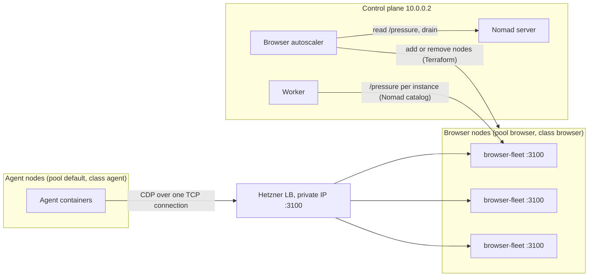

# Browser Pool: Dedicated Auto-Scaled Tier

**Status:** Draft. Not started. Plan only; nothing in this file has been implemented or applied.
**Created:** 2026-11-11
**Area:** Infrastructure, browser-pool, Nomad, Hetzner, Terraform, worker, agent runtime
**Depends on:** [bug 2026/11/08 001](../../../bug-reports/2026/11/08/001-browser-pool-registered-on-public-address-blocked-by-ufw.md) (private, static-port registration, already on staging). Interleaves with [sandbox UID egress](../000-sandbox-uid-egress/001-plan.md) (Phases 2 and 3 below must finish before its Phase 4 canary).
**Supersedes in part:** [Plan 002](../002-browser-pool-autoscale/001-plan.md), [Plan 003](../003-browser-pool-scale-foundations/001-plan.md), [Plan 004](../004-browser-pool-scale-to-thousands/001-plan.md). See [Plan changes](#plan-changes).
**Binding guide:** [Agent runtime rollout guide](../../../tech/agents/agent-runtime-rollout-guide.md). Node config before job requests, ship dark, prove one target, keep a fast rollback, `TF_DATA_DIR=.terraform-envs/<env>`, never apply a Terraform plan that has not been read.

---

## Goal

Run browser sessions on a dedicated tier of machines that grows and shrinks with demand. Agents use one stable address. Adding or removing a machine never needs an agent relaunch.

First, measure. We do not know the demand shape or the real memory per session, so nothing is sized from test-user traffic.

## Decisions taken by the owner

| # | Decision | Effect on this plan |
|---|---|---|
| 1 | One browser-pool instance per machine, many sessions per instance. Static port 3100 stays. | Dynamic ports are not needed. Plan 003 Phase 1 is dropped. |
| 2 | Browser instances run on their own Nomad node pool, auto-scaled. Job type becomes `system`. | One allocation per eligible browser node. Plan 003 Phase 3 and the Nomad scale API parts of Plan 002 are unnecessary. |
| 3 | Front door (Option B): one Hetzner Load Balancer in front of all browser machines. | Agents and the worker never need relaunching because the pool changed. Fallback is Option A (instance list lookup) if the Phase 3 spike fails. |
| 4 | Start on cx23 (4 GB). Grow 4, 8, 16, 32 GB (cx23, cx33, cx43, cx53). | Machine size is a config knob. Instance settings follow node size. Grow by adding new-size nodes and draining old ones, never by resizing live nodes. |
| 5 | Auto-scaling is required. Demand shape is unknown. Owner guess: 100k users, ~10k active, ~1,000 to 3,000 concurrent sessions, ~1 GB per session (unmeasured). | Conservative min/max and thresholds until measured. |
| 6 | First deliverable is measurement: always-on recording, then a staging load test. | Phase 1. |
| 7 | Staging stopgap approved: move `browser-pool` off agent-3 to a caps node, static 3100, before the sandbox relaunch. | Phase 2. |
| 8 | Oso agent (6f0d6e1b) start was acceptable. No owner scoping on the restart script for now. | Nothing to do. |
| 9 | The UID egress design allowlists by IP. A single stable front-door IP is ideal. | See [Address plumbing](#address-plumbing). |

Reference prices (third party, EUR per month ex VAT, verify with `hcloud server-type describe`): cx23 5.49, cx33 8.49, cx43 15.99, cx53 29.49.

## Plan changes

| Plan | What changes |
|---|---|
| 003 Foundations | Phase 1 (dynamic port): dropped. Phase 2 (multi-instance selection in the worker and agents): replaced by the front door; kept only as the Option A fallback. Phase 3 (count preservation): obsolete under a `system` job. Phase 4 (gate checks every instance): stays, and also checks the front door. |
| 002 Autoscale | Scaling block, Nomad scale API (D2), count preservation (D7), `scaling` guardrail (D8) and the two-level model (D1): superseded by node-level scaling. D3 (`/pressure` as the demand signal) stays. Scale-in must be session-aware (D5, Phase 3) and stays. |
| 004 Scale to thousands | Kept as the long-term target and measurement-gated. Interpreted as the owner's targets above. Its Phase 0 (measure) is pulled forward into Phase 1 here. |

Two corrections to earlier plans, found while reading the code:

- The browser adapter is `apps/worker/src/tools/browserless-adapter.ts`, not `packages/venues/...`. It runs inside the **agent process** (`apps/worker/src/agent.ts`, `BROWSER_POOL_URL`). The worker only resolves the address once at startup, hands it to agents, and runs the health publisher.
- Plan 002 relied on the placement-failure watcher as "level 2". `check-placement-failures.sh` reads evaluations only for the agent namespace (`NOMAD_AGENT_NAMESPACE`), and `browser-pool` lives in the default namespace. That level 2 would not have fired. Not needed here, since scaling is by node.

## Current state (verified read-only, 2026-11-10/11)

- Staging control plane `138.199.172.202`, `/opt/herobids` at `e1717e37`. Main is `c2526680` (docs only newer).
- Nodes (class `agent`, pool `default`): agent-caps-1 (`ae9393db`, 10.0.0.4, eligible, 1 agent), agent-caps-2 (`690b36fc`, 10.0.0.6, eligible, empty), agent-2 (`9fed1a12`, 10.0.0.3, ineligible, 3 agents), agent-3 (`714f26cc`, 10.0.0.5, ineligible, 4 agents + browser-pool). Eight agent jobs, all paper mode.
- `browser-pool`: count 1, static 3100 to 3000, `host_network "private"`, registered at `10.0.0.5:3100`. Job version 2 (submitted 2026-11-09 08:11 UTC) has the `update` block live. The allocation pre-dates the submit, so a group-level `update` change was applied in place. A same-spec resubmit therefore never exercises static-port release.
- Both caps nodes already have `host_network "private"` and the UFW rules for 3100. Each has 3819 MB RAM, with ~620 to 720 MB (about 17%) used idle by OS, Nomad and Docker.
- Browserless has **no authentication**. It must never be reachable from the public internet.
- Existing agent-pool tooling is tied to `NodeClass == "agent"`, `Meta.node_pool == server_name`, Hetzner labels `role=agent`, names `<pool>-agent-N`, and Terraform resources named `agent` (`check-nomad-capacity.sh`, `capacity-inventory.sh`, `scale-common.sh`, `scale-in-guard.sh`, `capacity-controller.sh`). A browser pool with a different class, labels and names is invisible to it. That is the intent.
- Agent Nomad jobs set no node class or pool constraint by default. A browser node in pool `default` could receive agents. This is why the tier needs its own Nomad **node pool**, not only a class.
- `push.sh` submits every `infra/nomad/*.nomad.hcl` on each deploy (`timeout 180`, failures are warnings).
- `SANDBOX_ALLOWED_HOSTS` accepts a comma-separated list of IPs or CIDRs (`scripts/sandbox-egress.sh`).

## Design

### Topology

### Node pool and job type

- Nodes join Nomad node pool `browser` with node class `browser` and node meta `browser_size=<server type>`. The pool keeps agents off these machines and browsers off agent machines. The class keeps the agent autoscaler, which filters on `NodeClass == "agent"`, from counting or removing them.
- The pool must exist before the first browser node registers. Create it with `nomad node pool apply` (needs a management token) and make it idempotent in `converge-control-plane.sh`.
- The job becomes `type = "system"` with `node_pool = "browser"`. Nomad is believed to reject a job type change on an existing job ID, so the new job gets a **new ID** (`browser-fleet`) and keeps the service name `browser-pool`. The health publisher, gate and admin panel keep working. Confirm the type-change rejection with `nomad job plan` (read-only) in Phase 0.
- The new job file lives in `infra/nomad/fleet/`, not `infra/nomad/`, so `push.sh` does not submit it until Phase 4 adds an explicit, flagged submit step. That is the ship-dark mechanism.
- No `count`, no `scaling` block, no Nomad scale API. Adding a node adds an instance.

### Per-size instance settings

`resources.memory` cannot be interpolated per node, so one job file has **one task group per size tier**, each with a constraint on `${meta.browser_size}` and its own `MAX_CONCURRENT_SESSIONS`, memory and CPU. Adding a size means adding a group. (Verify in Phase 0 that group resources cannot be interpolated; if they can, one group is simpler.)

| Node type | RAM | Container memory | MAX_CONCURRENT_SESSIONS | Source of the number |
|---|---|---|---|---|
| cx23 | 4 GB (3819 MB allocatable) | Provisional 2048 MB (today's known-good value) | Provisional 2 | Replace with Phase 1 results |
| cx33 | 8 GB | Phase 1 | Phase 1 | Formula below |
| cx43 | 16 GB | Phase 1 | Phase 1 | Formula below |
| cx53 | 32 GB | Phase 1 | Phase 1 | Formula below |

Formula: `sessions = floor((allocatable_mb - os_overhead_mb - headroom_mb) / measured_mb_per_session)`. Overhead is about 700 MB idle on cx23 and is measured again per size. Headroom, overhead and memory per session come from Phase 1, not from this plan. CPU per session is also unmeasured and may bind before memory on shared-vCPU `cx` types.

Confirm the container memory is a real cap (cgroup `memory.max`), so a runaway Chromium kills the container and not Nomad or Docker on the node.

Rough scale check, to be redone with measured numbers: 3,000 sessions at 1 GB is about 3 TB of browser memory, so about 100 cx53 nodes (about EUR 2,950 per month) or about 1,200 cx23 nodes. The Hetzner private network is believed to allow about 100 servers; that would cap the whole platform, agents included. Verify in Phase 0 (see Risks).

### Front door (Option B)

- One `hcloud_load_balancer` with a fixed private IP in the existing subnet, TCP service listening on 3100 and forwarding to 3100, algorithm `least_connections`, active health check on `/json/version`. Targets are the browser servers by label selector (`role=browser,environment=<env>`) over their private IPs, so autoscaled nodes join and leave without a Terraform edit to the LB.
- Same port on both sides keeps the existing UFW rules valid (`172.17.0.0/16` to the private subnet on 3100, and the control-plane routed rule for `172.18.0.0/16`).
- **The LB must be private-only.** Browserless has no auth. Hetzner load balancers get a public IP by default; third-party sources describe a "disable public interface" option. Confirm it exists in the API and in the Terraform provider, apply it, and prove it from outside (Phase 3). If it cannot be disabled, the front door is a no-go.
- **Why the adapter must change.** Today `BrowserlessAdapter` does `PUT {url}/json/new`, rewrites the returned WebSocket host to the configured URL, and the caller then opens a WebSocket. Through a load balancer the PUT and the WebSocket can reach different machines, and the WebSocket then fails. Fix: acquire a session by opening one WebSocket to the front door (one connection is one session on one machine) and release it by closing the socket. The `agent-browser` CLI already works this way (`AGENT_BROWSER_CDP_URL=ws://host:port`). With a single target (the stopgap) the current flow works unchanged, so the address can go live first and the adapter change is needed only before a second target is added.
- **Sticky options are not available.** Hetzner TCP services have no source-IP affinity, so the stickiness route is closed. The direct WebSocket route, or Option A, are the only ways.
- `CdpClient` (`apps/worker/src/tools/browser.ts`) connects to a page-level endpoint and sends `Page.enable` straight away. A browser-level connection needs `Target.createTarget` and `Target.attachToTarget` (flattened sessions). Size this in the spike. Also note the Node `WebSocket` error event does not expose the HTTP status of a rejected upgrade, so a 429 may look like a generic connect error. Map it, or check `/pressure` first.

### Address plumbing

- Add `browserPool.frontDoorUrl` (default empty) to `BrowserPoolConfigSchema` and `config/default.yaml`. It is the **agent-facing** address. `config/staging.yaml` and `config/production.yaml` set it to the LB private IP URL (a private address in a committed file is acceptable; if an env override is chosen instead, update the `.example` twin in the same change).
- `apps/worker/src/index.ts`: agent-facing URL becomes `frontDoorUrl || url || registry.resolve('browser-pool')`.
- Do **not** reuse `browserPool.url` for the front door. The health publisher treats a non-empty `url` as the only instance and would poll the load balancer, seeing one random instance. The publisher must keep enumerating instances from the Nomad catalog.
- `AGENT_BROWSER_CDP_URL`, `BROWSER_POOL_URL` and `SANDBOX_ALLOWED_HOSTS` are derived from the resolved URL in `buildAgentEnv` (`apps/worker/src/agents/runtime-lifecycle.ts`), and the hostname is used as is when it is already an IP. No code change is needed there. With the front door set, agents get `BROWSER_POOL_URL=http://<lb-ip>:3100`, `AGENT_BROWSER_CDP_URL=ws://<lb-ip>:3100`, `SANDBOX_ALLOWED_HOSTS=<lb-ip>`. One IP, no per-instance entries.
- Check `BROWSERLESS_API_KEY` (already forwarded from `browserPool.apiKey`): the adapter does not appear to use it. Confirm in Phase 6.

### Terraform layout (recommendation, owner to confirm at the start of Phase 3)

Put the LB and browser nodes in a **separate root module with its own state key** (`infra/hetzner/browser-tier/`, state key per env), looking up the network, SSH key and firewall as data sources.

Reason: the agent autoscaler plans and applies the main state with an allowlist that only permits `hcloud_server.agent[*]` changes. Browser resources in the same state would show as destroy-and-create whenever the agent autoscaler runs without the browser variables, which would block agent scale-out or, if unguarded, delete browser nodes. A separate state removes that coupling and gets its own lock.

Inside the module, nodes are `for_each` over a map of node name to server type, not `count`. Scale-in must delete the specific drained node. A `count` can only remove the highest index, which may not be the idle one. `server_type` must never change for an existing key (`lifecycle { ignore_changes = [server_type] }` plus a plan check), because a type change makes the provider rescale and power the server off. The node map lives in a machine-owned JSON var file per env, written by the autoscaler. Hand-edited `<env>.tfvars` stays untouched.

If the owner prefers the single state, the alternative is to pass the browser var file on every main-state run and extend the allowlists. This plan does not recommend it.

## Rollout rules for every phase

- Any mutating step on staging or production needs owner approval, named in the phase. Read-only checks need none.
- Terraform: `TF_DATA_DIR=.terraform-envs/<env>`, plan first, read the plan, apply only a saved, reviewed plan. A destroy that is not expected is a stop.
- No Terraform command that can write to the S3 backend without approval (`apply`, `workspace new`, `output` or `init` against a made-up workspace).
- Node image pull before job request. One node before many. Record node ID, private and public IP, host key fingerprint, Nomad version for each new node in a rollout log (`003-rollout-log.md` in this folder).
- Keep one Nomad version across the browser pool. Pin `nomad_version` to the control plane's version (1.9.7 today).
- Any new environment variable gets its `.example` twin updated in the same change. Operator config (`config/*.yaml`, Terraform variables) stays separate from instance config.
- Production is pre-launch and can be rebuilt, but it gets the same gates.

---

## Phases

### Phase 0: Baseline and docs corrections

No behaviour change. Read-only except the docs commit.

- [ ] Record baseline: `nomad job status browser-pool`, `nomad node status` for all four nodes (class, pool, version, eligibility, allocatable), the Browserless image digest in use, `ss -ltnp | grep 3100` on the pool node. Write it to the rollout log.
- [ ] Hetzner facts (read-only, `hcloud`): `hcloud server-type describe` for cx23, cx33, cx43, cx53 (price, vCPU, RAM); `hcloud load-balancer-type describe` for lb11, lb21, lb31 (targets, services, connections, price); project limits (servers, load balancers, primary IPs); network limits (servers per network, subnet size). Confirm cx23 is orderable in the staging location, and what a rescale requires (power-off). Do not print the API token.
- [ ] Verify with `nomad job plan` on a throwaway copy of the spec (read-only): changing `type` on job ID `browser-pool` is rejected; a `node_pool` that does not exist is rejected; group `resources` cannot be interpolated.
- [ ] Terraform state check (approval if it needs the S3 backend): confirm `.terraform-envs/staging` exists, then a read-only plan (`-lock=false`) to learn the current drift. Note that agent-3 is not in state.
- [ ] Docs corrections, one docs-only commit:
  - [browser-pool.md](../../../tech/architecture/browser-pool.md): the `update` block is live (job version 2, 2026-11-09 08:11 UTC); remove the "Pending" redeploy-test row and the "staging still runs the version without it" text; explain that a same-spec resubmit is applied in place and cannot test port release; the destructive-update test moves to Phase 4. Update "As of".
  - [Bug 2026/11/08 001](../../../bug-reports/2026/11/08/001-browser-pool-registered-on-public-address-blocked-by-ufw.md): the status line says "Not committed" and "await deployment". The update block, the gate change and the `maintenance-restart.sh` label fix are committed (`89b55d20`, `f3716323`) and on `origin/main`. Fix the status line and the "Staging test" note.
  - Correct the adapter path in Plan 002's status block (see [Plan changes](#plan-changes)).
- [ ] Decide the Browserless version to pin (tag or digest of what staging runs now). `:latest` is not acceptable past Phase 2.

**Acceptance:** baseline and Hetzner facts recorded; the three Nomad checks answered; docs match git.
**Gate:** no staging or production change was made.
**Rollback:** revert the docs commit.

### Phase 1: Measurement

No behaviour change in agents.

#### 1a. Always-on recording

Today the health publisher polls `/pressure` every 15 s and writes a Redis snapshot with a 60 s TTL. Nothing is kept.

- [ ] Add a sample sink port in `@herobids/domain` (same pattern as the `MetricsSink` in [observability.md](../../../tech/architecture/observability.md): a port, a default structured-log sink, no new runtime dependency).
- [ ] Record per instance, rolled up per minute: max and average running sessions, `maxConcurrent`, max queued, rejected count in the window, CPU and memory pressure from `/pressure`, and task memory (RSS and cache) from the Nomad allocation stats API if the worker token may read it (verify; otherwise use node-level memory from the health snapshot).
- [ ] Store samples in Postgres: new table `browser_pool_samples` (Drizzle schema in `packages/db`, migration generated with `drizzle-kit generate`). Retention purge on a timer.
- [ ] New operator config under `browserPool.metrics` in `BrowserPoolConfigSchema` and `config/default.yaml`: `enabled` (default off, on in staging), `rollupSeconds`, `retentionDays`. No hard-coded numbers in code.
- [ ] A recording failure logs a warning and never stops the health publish (every loop reschedules itself).
- [ ] Session facts: confirm `browser.session_ms` usage events (billing) give session duration on staging. Capture acquire latency and outcome (`ok`, `queue_full`, `timeout`, `unavailable`) at the adapter. First check how agent-process logs reach the operator. If they do not, carry them on the existing usage event path, not a new channel.
- [ ] A saved query set in the runbook for peak sessions per day, queue and rejection counts, and sessions per node.

**Acceptance:** after 24 h on staging, every instance has a row per minute with no gap longer than two intervals; flag off gives behaviour identical to today; a Redis or Postgres failure does not break the admin panel.
**Rollback:** `browserPool.metrics.enabled: false` and restart the worker.

#### 1b. Staging load test

Needs approval (creates temporary paid servers on staging).

- [ ] Harness in `scripts/ts/` (or `scripts/shell/tests/`): parameters are target URL, concurrency steps (1, 2, 4, 8, 16, 24, 32), workload profile, hold time. It records per step: successes, 429s, timeouts, session start time p50 and p95, node memory and CPU, Chromium crashes, container OOM kills, time to recover.
- [ ] Workload profiles: light static page, heavy JavaScript site, long idle session. Choose real sites agents visit (from `browse_interactive` usage; open question).
- [ ] Test bed: temporary servers on the staging private network, outside Nomad and outside the agent pools, running the pinned Browserless image with the same env as the job. Start with a cx23 and a cx43. No public inbound except SSH. The load generator runs on a **separate** temporary server. Never publish port 3100 on a public interface.
- [ ] Questions to answer: GB per session at steady state and at peak, per profile; stable concurrency per node size; behaviour at and past `MAX_CONCURRENT_SESSIONS` and `QUEUE_LENGTH` (when 429, when timeout); session start time under load; CPU per session; Chromium leaks over a 1 to 2 hour soak; effect of `/dev/shm` and `--disable-dev-shm-usage`; whether Browserless is stable with 10 to 30 sessions in one container (required before cx33 and up); whether `/pressure` memory matches real memory; the Browserless 60 s `TIMEOUT` versus the 180 s `maxSessionDurationMs` in config (nothing reads the latter).
- [ ] Write results to `002-measurements.md` in this folder, with a recommended `MAX_CONCURRENT_SESSIONS`, memory and CPU per size, and a go or no-go for cx33, cx43 and cx53.
- [ ] Delete the temporary servers and confirm with `hcloud server list`. Keep the cx23 and cx43 servers until Phase 3 if the spike reuses them as targets (owner decides).

**Acceptance:** measured GB per session per profile, not assumed; per-size settings recommended; first real numbers for session duration and start time.
**Gate:** `002-measurements.md` reviewed by the owner before any sizing in Phase 4.
**Rollback:** delete the temporary servers; recording flag off.

### Phase 2: Staging stopgap (browser-pool to a caps node)

Goal: agents launch once, with the final address. This phase and Phase 3's front-door step must finish before the sandbox plan's **Phase 4** (canary relaunch), because the canary also bakes the address in. Otherwise the canary needs one more relaunch. Browsing downtime on staging is accepted.

Approval points are marked.

- [ ] Capacity check (read-only): sum the `MemoryMB` of the eight agent job specs, add the pool (2048 MB) and ~700 MB overhead per node, and compare with the two caps nodes (2 x 3819 MB). If it does not fit, stop and ask the owner: this reopens sandbox decision 6 (a third caps node).
- [ ] Update `infra/nomad/browser-pool.nomad.hcl`: pin the image to the Phase 0 tag or digest. Nothing else changes (still `service`, count 1, static 3100).
- [ ] `nomad job plan` (read-only). Expect a destructive update. Agent-3 is ineligible, so the replacement must be planned on a caps node, and the old allocation stops after the new one is healthy. If the plan shows anything else, stop.
- [ ] **Approval:** pre-pull the pinned image on the target caps node with `docker pull`.
- [ ] **Approval:** `nomad job run -check-index <n>` with the reviewed plan. Do not pin the placement to a node name in the committed file. If the owner wants a specific node, mark the other caps node ineligible for the duration and re-enable it after.
- [ ] Confirm `ss -ltnp | grep 3100` on the new node and that agent-3 released it.
- [ ] **Approval:** restart the worker (it resolves the pool once at startup) using the normal staging worker restart, not a full deploy.
- [ ] Run `infra/hetzner/scripts/smoke-test-browser-pool.sh --env staging 138.199.172.202` **twice**; both must pass.
- [ ] Hand back: add a one-line pointer in the sandbox plan (Phase 6, first item): the "browser-pool runs on a caps node" check is already satisfied.
- [ ] Agents launched before this change still hold `BROWSER_POOL_URL=http://10.0.0.5:3100`. That is expected. They are relaunched in the sandbox plan.

**Acceptance:** pool allocation on a caps node at `10.0.0.x:3100`, health check green, gate passes twice, worker logs the new URL.
**Gate:** do not start the sandbox canary until Phase 3 step 3.3 is done or step 3.2 declares no-go (then agents get the stopgap address and the extra relaunch is accepted openly).
**Rollback:** resubmit the previous job version (from `nomad job inspect` saved in the rollout log) after the owner sets agent-3 eligible again, or let it place on the other caps node. Restart the worker. Browsing was already down for old agents, so there is no new loss.

### Phase 3: Front-door spike and go/no-go

Goal: prove the load balancer as the single agent-facing address, then give agents that address before the canary.

#### 3.1 Throwaway spike (approval: creates a temporary LB and servers)

Run against a **throwaway** load balancer and the Phase 1 temporary servers (or two new temporary servers), not against the real pool.

- [ ] Owner confirms the Terraform layout (separate root module, see Design). Create the spike LB with Terraform in the new module, or with `hcloud` and delete after. Read the plan.
- [ ] S1, split: with the **current** adapter and two targets, `PUT /json/new` followed by WebSocket through the LB. Expect failures when they land on different machines. Records the problem.
- [ ] S2, direct WebSocket: acquire and release with one WebSocket per session through the LB, across both targets. Find the supported Browserless flow for a single connection on the pinned version, and size the `CdpClient` change (`Target.createTarget`, flattened sessions).
- [ ] S3, limits through the LB: at `MAX_CONCURRENT_SESSIONS` plus `QUEUE_LENGTH`, what does a new connection receive (429, hang, reset)? Can the client tell it from a network error?
- [ ] S4, idle: a connection idle for 5 minutes. Does the LB drop it? What is the LB idle timeout?
- [ ] S5, health and removal: stop one Browserless container; time to unhealthy and back. Remove a target while a session is open; do open connections survive? This decides how scale-in drains (Phase 5).
- [ ] S6, label selector: a new server with the matching label becomes a target on its own; a server that gains a `draining` label leaves rotation, using a label selector that excludes that label (verify the exclusion syntax in the Hetzner docs; if it does not exist, drain by removing the `role` label instead).
- [ ] S7, private only: disable the public interface (API action or provider setting). From outside the network, probe the LB's public IPv4 and IPv6 on 3100 and 80/443. All must fail. From a staging agent node host and from a Docker bridge container, 3100 on the private IP must work.
- [ ] S8, limits: targets per LB type, connections per type, hourly price, any per-server target limit for label selectors.

#### 3.2 Go or no-go

- [ ] **Go (Option B)** if S2, S3, S5 (known behaviour), S6 and S7 pass. Write an ADR (`docs/tech/architecture/adrs/2026/11/019-browser-pool-front-door.md`) with the results.
- [ ] **No-go (Option A)** otherwise: agents resolve the instance list. State plainly in the ADR what that costs: the Plan 003 Phase 2 work (per-session instance choice in the adapter, an agent-side resolver or a refresh, a per-session allowlist), and that running agents hold a fixed egress allowlist, so new instances need a dedicated browser subnet allowlisted as a CIDR (supported by `SANDBOX_ALLOWED_HOSTS`) or an agent relaunch per scale event. If no-go, agents launch in the sandbox plan with the stopgap address, and one more relaunch is needed when the dedicated tier replaces it. Say this openly to the owner.
- [ ] Delete the spike LB and temporary servers; confirm.

#### 3.3 Real front door with a single target (only after Go; approval)

- [ ] Add `browserPool.frontDoorUrl` and the `index.ts` change (see [Address plumbing](#address-plumbing)). Tests: with the front door set, agent env carries the LB IP and the publisher still enumerates the Nomad catalog.
- [ ] Terraform (flag `browser_front_door_enabled`, default false; fixed private IP variable): LB, network attachment, TCP service 3100, health check, one explicit **server target**: the caps node that runs the stopgap. Read the plan; it must show additions only.
- [ ] Apply the public-interface disable and repeat S7 on the real LB.
- [ ] Set `config/staging.yaml` `browserPool.frontDoorUrl`, deploy, restart the worker. Confirm the worker logs the LB URL.
- [ ] Update the gate (Plan 003 Phase 4): probe the front door from the control plane and from each agent node (host and Docker bridge); keep the per-instance catalog probes; take the front-door address from the same config the worker reads.
- [ ] Run the gate twice. One agent test: `browse_interactive` open, snapshot, close; and `agent-browser` from the sandbox (`scripts/shell/tests/browser-pool-agent-browser-smoke-test.sh` pattern).
- [ ] Build the adapter change (direct WebSocket) behind `browserPool.directWebSocket` (default false, current flow unchanged) and unit test it. Do not enable it until a second target exists (Phase 4).

**Acceptance:** agents started after this point get the LB IP; the stopgap pool serves sessions through the LB; the LB is unreachable from outside the private network.
**Gate:** two clean gate runs; S7 repeated on the real LB; owner sign-off before the sandbox canary.
**Rollback:** the LB is the lever. Re-point the target to another node, or set `frontDoorUrl` empty and restart the worker (new agents then use the catalog address). Agents already launched keep the LB IP, so keep the LB valid until all of them have relaunched.

### Phase 4: Dedicated browser node pool (ship dark)

- [ ] Parameterise `infra/hetzner/cloud-init-nomad-client.yaml` with `node_class`, `nomad_node_pool` and `node_meta` (defaults reproduce today's agent output) rather than forking it. Add a test that renders the agent case and diffs it against the current output. Browser variant: class `browser`, pool `browser`, meta `browser_size`, no `ghcr` login, no agent image pull, pull the pinned Browserless image, UFW allows 22 and 3100 from the private subnet only (no `172.17.0.0/16` rules).
- [ ] Node health: the existing `agent-node-health.sh` timer publishes memory for the admin panel as `agent-server`. Give browser nodes their own server type so they show separately.
- [ ] `converge-control-plane.sh`: idempotent ensure of node pool `browser`, with a test in `test-converge-control-plane.sh`.
- [ ] Browser module (Terraform): `for_each` nodes, names `<server_name>-browser-<tier>-<n>`, labels `role=browser`, `environment`, `node_pool`; firewall that mirrors `hcloud_firewall.agent` minus anything not needed (read it first); public IPv4 for outbound browsing, IPv6 off like agents; node map from the machine-owned var file; defaults give an empty map. LB target becomes the label selector.
- [ ] Job `infra/nomad/fleet/browser-fleet.nomad.hcl`: `type = "system"`, `node_pool = "browser"`, one group per size tier with a `${meta.browser_size}` constraint, static 3100 on `host_network "private"`, pinned image, service `browser-pool` with the existing `/json/version` check, `update { max_parallel = 1, auto_revert = true, health_check = "checks" }`, memory and sessions from `002-measurements.md`. `push.sh` gets a flagged submit step for `infra/nomad/fleet/`.
- [ ] **Approval, then one node (rollout guide step 4):** create the node pool, then one cx23 node. Record identity, fingerprint, version, `allow_caps`. Verify the chain: node registers in pool `browser` and class `browser`; agent jobs are not placed on it (plan a test agent job read-only); `browser-fleet` places exactly one allocation; service registered on the private IP; LB target healthy; session round trip through the LB; gate passes.
- [ ] Destructive-update test (replaces the meaningless redeploy test): bump a harmless env var, run `nomad job plan`, run, and confirm the old allocation releases 3100 before the new one binds, health goes green, no failed placement. Test `auto_revert` with a deliberately bad image tag on this one node.
- [ ] **Approval, second node:** add a second cx23 node. Enable `browserPool.directWebSocket`. Run the gate (front door plus every instance). Run a concurrent load (reuse the Phase 1 harness) and check that sessions spread across both nodes and no session fails at connect.
- [ ] **Approval, cutover:** remove the stopgap server target from the LB, `nomad job stop -purge browser-pool`, and delete `infra/nomad/browser-pool.nomad.hcl` in the same change so `push.sh` stops re-creating it. Agents are unaffected (same address). The caps node gets its memory back.
- [ ] Keep node Nomad version identical to the control plane.

**Acceptance:** two browser nodes serve sessions behind the front door; the stopgap is gone; agent nodes and agents never saw a change; the gate passes twice.
**Gate:** direct WebSocket proven under concurrent load on two nodes before cutover.
**Rollback:** re-add the stopgap target and `nomad job run` the saved stopgap job (keep a copy in the rollout log until Phase 6 passes); `directWebSocket` off. Browser nodes can be removed with a reviewed Terraform plan.

### Phase 5: Autoscaler for the browser node pool

#### 5a. Scale-out first

- [ ] Design note (short, in this folder): which parts of `scale-common.sh` can be reused. Recommendation: new `browser-scale-out.sh` and `browser-scale-in.sh` that source `scale-common.sh` and `alert-common.sh` for logging, Nomad API calls, locking, cooldown, backend init and alerts, and do not touch `capacity-*.sh` (agent specific). Use the browser module's own state key and lock file. Reuse the systemd service and timer pattern.
- [ ] Demand signal: read `/pressure` from every instance in the Nomad catalog (`running`, `maxConcurrent`, `queued`, `recentlyRejected`). Compute capacity in **sessions**, not nodes, so mixed sizes work. The agent autoscaler's single-size node template (`nomad_node_template_memory_mb`, `nomad_node_template_cpu_mhz`) is not reused.
- [ ] Rule: scale out when utilisation is above the threshold, or any queue, or any recent rejection, or free sessions fall below a floor (lead time for a new node is minutes). Bounds from Terraform variables, one cooldown, one increment, a hard maximum node count.
- [ ] Provisional values (replace after Phase 1 and a week of staging data): staging min 1, max 3; production min 1, max 3; increment 1; cooldown 300 s; threshold 70%. These are placeholders, not sizing.
- [ ] Terraform variables, documented in `variables.tf` and the example tfvars twins (`environment.tfvars.example`, `terraform.tfvars.example`): `browser_autoscale_enabled` (default false), `browser_min_nodes`, `browser_max_nodes`, `browser_node_server_type` (the size new nodes get), `browser_scale_out_utilization_pct`, `browser_scale_out_increment`, `browser_scale_cooldown_seconds`, `browser_min_free_sessions`. Any env var the units read gets its `.example` entry in the same change (check `render-autoscale-settings.sh`).
- [ ] Measure node-ready time (create to registered to LB healthy). Pre-pulling the image in cloud-init is the main lever. Feed it into the free-session floor.
- [ ] Alerts via `alert-common.sh` after N consecutive failures; an alert when the maximum is reached while demand persists.
- [ ] Tests in `infra/hetzner/scripts/tests/` with the existing fake Nomad pattern: dry-run, disabled flag exit code, bound enforcement, cooldown, mixed sizes, a failed apply.
- [ ] **Approval:** enable on staging with `--dry-run` for a day, then live with max 3. Drive load with the Phase 1 harness. Verify: scale from 1 to 2 nodes, new node joins the LB by label, sessions reach it, no agent relaunch.

#### 5b. Session-aware scale-in

- [ ] Candidate: a node with zero running and zero queued sessions for a configured number of consecutive observations, and remaining capacity after removal still above the floor and below the scale-in utilisation target.
- [ ] Drain steps, using what S5 showed: add label `draining=true` so the LB stops sending new connections; wait for `running == 0` up to a deadline derived from the session timeout plus margin; if the deadline passes with live sessions, **abort and restore the label**, never kill; then `nomad node drain`, then remove that node's key from the node map and apply a reviewed plan that destroys only that server and its attachment.
- [ ] Guard like `scale-in-guard.sh`: refuse any plan that destroys more than the intended node, or anything but browser resources.
- [ ] Never scale in below `browser_min_nodes`. Stagger removals.
- [ ] Settle the session timeout mismatch first (Browserless `TIMEOUT` 60 s versus 180 s in config): one source for both, so the drain deadline has one number to follow.
- [ ] **Approval:** enable scale-in on staging last. Test under load: scale down while sessions run; no live session is cut.

**Acceptance:** under synthetic load the node count rises and falls within bounds; no session is cut by scale-in; alerts fire on repeated failure; cost per hour is visible.
**Gate:** scale-in is not enabled in any environment until the under-load test passes.
**Rollback:** `browser_autoscale_enabled=false` stops both loops; set the node map by hand with a reviewed plan.

### Phase 6: Security hardening and observability

- [ ] Private-only proof, repeated for: the LB public interface, every browser node public IP on 3100, and the Hetzner firewall. Add an external probe to the gate (from a host outside the network, expect refusal).
- [ ] Authentication decision. Without a token, any container that can reach the pool can probably list other agents' sessions (`/sessions`, `/json/list`) and attach to them. Verify this with two test sessions on staging. Options: private-network only; a Browserless `TOKEN` (the `BROWSERLESS_API_KEY` plumbing exists; the adapter and CLI would need to send it); disabling the listing endpoints if Browserless allows it. Record the decision in the ADR.
- [ ] Egress from browser nodes: Chromium on these nodes can reach the private network, the control plane and the metadata address. Add Docker egress rules on browser nodes (`DOCKER-USER`: drop new connections from the Docker bridge to RFC 1918 and `169.254.0.0/16`). Inbound LB traffic is unaffected. Test: a session navigating to a control-plane address or the metadata address fails; sessions to public sites work. Also check whether `browse_interactive` blocks private destinations at the tool layer (`browser.ts` validates scheme); the network rule is the reliable control.
- [ ] Observability and cost: confirm `browser.session_ms` metering is recorded for every session across all instances; add node cost to the picture (node count by size times price); a query or panel for cost per session and cost per hour; the admin Browser Pool panel shows one row per instance and the front door.
- [ ] Alerts: queue depth or rejections above a threshold for longer than the cooldown; an instance unhealthy; max nodes reached; monthly spend above the owner's ceiling (once set).
- [ ] Update [browser-pool.md](../../../tech/architecture/browser-pool.md) to the new topology and write the runbook: add a node, drain a node, pause the autoscaler, re-point the LB, rebuild the pool.

**Acceptance:** no pool port answers from outside the private network; the auth decision is recorded; the egress rules are proven; the admin panel and cost query show every instance.

### Phase 7: Size growth procedure (4, 8, 16, 32 GB)

Never resize a live node: a Hetzner rescale needs a power-off (verify in Phase 0), and the provider would do it on a type change.

- [ ] Prerequisite per step: Phase 1 shows Browserless is stable at the session count for that size.
- [ ] Add the size group to `browser-fleet.nomad.hcl` with the measured settings. Add the size to the variable validation.
- [ ] Procedure: set `browser_node_server_type` to the new size, let (or force) the autoscaler add new-size nodes, wait for them healthy in the LB, then drain old-size nodes with the Phase 5b steps and remove their keys. Mixed sizes coexist during the move; the autoscaler counts sessions, so this is safe.
- [ ] Write the steps as a runbook with the rollback (keep old nodes until new ones carry load).
- [ ] **Approval:** rehearse 4 GB to 8 GB on staging under load. Repeat for each size only after its Phase 1 numbers exist.

**Acceptance:** a size change completes under load with no cut session and no agent change.
**Rollback:** set the previous size and repeat in reverse; old nodes are kept until the new tier is proven.

### Phase 8: Production rollout

Production is pre-launch and can be rebuilt. It does not run the pool today, so this is a first install, not a migration.

- [ ] **Approval:** owner confirms production values (min, max, size, spend ceiling).
- [ ] Repeat Phases 3.3, 4 and 5a on production in order, with the same gates and reviewed plans. Production Terraform uses `TF_DATA_DIR=.terraform-envs/production`, never the shared `.terraform/`.
- [ ] Enable scale-out with the conservative provisional bounds. Enable scale-in only after the staging under-load test and a week of production data.
- [ ] Watch the first days; tune thresholds from recorded data.

**Acceptance:** the production gate passes twice; the autoscaler holds capacity above the floor; no public exposure.
**Rollback:** `browser_autoscale_enabled=false`; remove nodes with a reviewed plan; set `frontDoorUrl` empty and restart the worker.

---

## Test strategy

| Level | What |
|---|---|
| Unit (Vitest) | Adapter direct-WebSocket acquire and release, error mapping (queue full, timeout, unavailable); `CdpClient` browser-level flow; `BrowserPoolConfigSchema` for `frontDoorUrl` and `metrics`; `index.ts` agent URL precedence; the publisher keeps catalog enumeration when `frontDoorUrl` is set; sample rollup and retention; recorder failure isolation; flag-off output unchanged. |
| Repository / DB | `browser_pool_samples` insert, rollup, purge (existing db test setup). |
| Shell (`infra/hetzner/scripts/tests`) | Autoscaler dry-run, disabled exit code, bounds, cooldown, mixed sizes, scale-in guard, failed apply; converge node-pool step; cloud-init render diff for the agent case. |
| Terraform | `validate`, and plan fixtures reviewed by a person: additions only for browser resources; no `server_type` change on an existing key. |
| Integration (staging) | Gate (front door plus every instance) twice per change; destructive-update test; two-node concurrency; scale-out and scale-in under load. |
| Load / soak | Phase 1 harness per size; soak 1 to 2 hours. |
| Visual | Admin Browser Pool panel shows one row per instance. |

## Risks

| Risk | Mitigation |
|---|---|
| LB cannot be made private-only, or the public interface is reachable | S7 is a go/no-go. External probe in the gate. Fall back to Option A. |
| WebSocket through the LB behaves differently (idle drop, 429 not visible) | S3 and S4 before go. Map errors or check `/pressure` before connect. |
| Memory per session is far above 1 GB, or CPU binds first | Phase 1 before any sizing. Sizes beyond cx23 are gated on measured stability. |
| Hetzner private network caps at about 100 servers, which would cap agents and browsers together | Verify in Phase 0. If true, a second network for the browser tier and an LB that can reach it becomes a design item before the 1,000+ session target. |
| Server quota, primary IP limit, API rate limits stop scale-out | Read limits in Phase 0. Alert on failed create. Hard maximum in variables. |
| Cost runaway | Hard maximum, spend alert, cost per session metric. Budget ceiling is an open question. |
| Shared Terraform state couples agent and browser autoscalers | Separate root module and state (recommended). Otherwise extend allowlists and pass the var file on every run. |
| Scale-in cuts a live session | Label-based drain, abort on deadline, guard plan, under-load test before enabling. |
| Scale-out lead time exceeds demand growth | Free-session floor, image pre-pull, node-ready time measured. |
| Stopgap displaces agents on caps nodes | Capacity check in Phase 2; stop and ask before adding a caps node. |
| Agents hold the LB address, so a bad LB cannot be swapped by relaunch | Keep the LB stable; use targets as the lever; never delete the LB while agents run. |
| Unauthenticated pool lets one agent reach another's session | Phase 6 verification and decision. |
| Chromium on browser nodes reaches the private network | DOCKER-USER egress rules in Phase 6. |
| Mixed Nomad versions | Pin one version for the browser pool. |
| `push.sh` re-creates the retired stopgap job | Delete the old job file in the cutover change. |

## Out of scope

- Production changes before staging gates pass.
- Resizing live nodes.
- Multi-region placement and sharding across clusters (Plan 004 Phase 6), unless the network limit forces a second network.
- Per-agent browser isolation or per-agent tokens.
- Changing how agents decide when to browse.
- The `maintenance-restart.sh` owner scoping (decision 8).
- Retiring agent-3 and agent-2 (sandbox plan Phase 6).

## Open questions

1. Budget ceiling per month for the browser tier, and whether to alert or stop at it.
2. Demand shape: sessions per active agent, session length, daily and weekly peaks. Phase 1 gives staging data only; production-like numbers come after launch.
3. Peak concurrency target (1,000 to 3,000 is a guess) and the acceptable wait before a session starts.
4. Browserless authentication: private-only, token, or listing endpoints disabled.
5. Does the Hetzner private network limit (about 100 servers) apply to this account, and is a second network acceptable?
6. One session timeout: keep 60 s, or raise `TIMEOUT` to match the 180 s config?
7. Terraform layout: separate root module and state (recommended) or the main state.
8. Workload profiles for the load test: which sites do agents actually visit?
9. Where do agent-process acquire metrics go today?
10. Do browser egress IPs need reputation or allow-listing work at scale?

## Links

- Current state: [browser-pool.md](../../../tech/architecture/browser-pool.md)
- Rollout guide: [agent-runtime-rollout-guide.md](../../../tech/agents/agent-runtime-rollout-guide.md)
- Superseded in part: [Plan 002](../002-browser-pool-autoscale/001-plan.md), [Plan 003](../003-browser-pool-scale-foundations/001-plan.md), [Plan 004](../004-browser-pool-scale-to-thousands/001-plan.md)
- Sandbox egress: [000-sandbox-uid-egress](../000-sandbox-uid-egress/001-plan.md)
- Infra lessons: [lessons-learnt.md](../../../../infra/hetzner/docs/auto-scaling/lessons-learnt.md)
- Adapter: `apps/worker/src/tools/browserless-adapter.ts`; CDP client: `apps/worker/src/tools/browser.ts`; env build: `apps/worker/src/agents/runtime-lifecycle.ts`; publisher: `apps/worker/src/browser-pool-health-publisher.ts`
- Gate: `infra/hetzner/scripts/smoke-test-browser-pool.sh`
