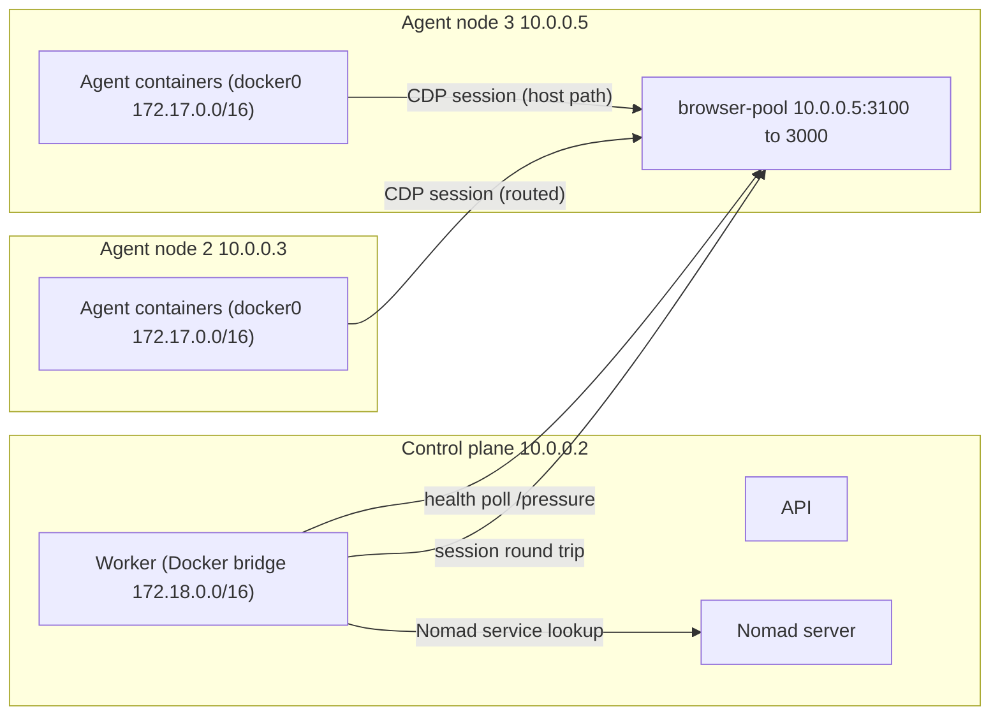

# Browser Pool — Current State

**As of:** 2026-11-08 (staging). Production is pre-launch and not yet on this design.
**Scope:** what runs today, how it is wired, how it is verified, and what does not exist yet.
**Goal and plans:** see [Plan 003 (foundations)](../../features/pending/003-browser-pool-scale-foundations/001-plan.md) and [Plan 004 (scale to thousands)](../../features/pending/004-browser-pool-scale-to-thousands/001-plan.md).

## Summary

- The browser pool is a single [Browserless](https://www.browserless.io/) Chromium instance run as a Nomad service job. It serves `browse_interactive` and the `agent-browser` CLI for agents.
- It runs on one agent node at `10.0.0.5:3100` (staging). The address is on the Hetzner private network.
- There is **no autoscaling**. The job has `count = 1` and no `scaling` block. No autoscale script or Terraform variable exists for the pool.
- Only one instance is supported end to end. The worker gives agents one URL, and it resolves that URL once at startup.

## Topology (staging)

## Components

| Component | Where | Current state |
|---|---|---|
| Nomad job `browser-pool` | [browser-pool.nomad.hcl](../../../infra/nomad/browser-pool.nomad.hcl) | `count = 1`, static port `3100` to container `3000`, `host_network = "private"`, `MAX_CONCURRENT_SESSIONS = 2`, `QUEUE_LENGTH = 10`, `TIMEOUT = 60000`, 2048 MB, health check on `/json/version` every 10 s. Explicit `update` block (`max_parallel = 1`, `auto_revert = true`) is in the repo; staging still runs the job version without it until the redeploy test. |
| Nomad service registration | same job | Provider `nomad`. Registers the private address, not the public NIC. |
| Agent-node Nomad client | [cloud-init-nomad-client.yaml](../../../infra/hetzner/cloud-init-nomad-client.yaml) | Declares `host_network "private"` (`10.0.0.0/24`). Existing staging nodes were patched by hand on 2026-11-08. Cloud-init applies the change only to new nodes. |
| Agent-node firewall | same file | Allows `3100` from `10.0.0.0/24` and `172.17.0.0/16`. Routes `172.17.0.0/16` to `10.0.0.0/24` on `3100`. |
| Control-plane firewall | [cloud-init.yaml](../../../infra/hetzner/cloud-init.yaml), [converge-control-plane.sh](../../../infra/hetzner/scripts/converge-control-plane.sh) | Routes `172.18.0.0/16` (worker) to `10.0.0.0/24` on `3100`. Converge applies it on every deploy. |
| Worker resolution | [index.ts](../../../apps/worker/src/index.ts), [service-registry.ts](../../../apps/worker/src/agents/service-registry.ts) | Resolves one URL at startup: static `browserPool.url` if set, else Nomad lookup. `browserPool.url` is `""` on staging and production. |
| Agent env | [runtime-lifecycle.ts](../../../apps/worker/src/agents/runtime-lifecycle.ts) | `BROWSER_POOL_URL` and `AGENT_BROWSER_CDP_URL` are set from that one URL at launch. A running agent keeps its URL until it relaunches. |
| `browse_interactive` | [browserless-adapter.ts](../../../apps/worker/src/tools/browserless-adapter.ts) | Acquires a session with `PUT /json/new` under a 10 s timeout (`browser_pool.timeout` on expiry). Rewrites the CDP host to the configured pool address. |
| `agent-browser` CLI | [browser-automation.md](./../agents/tools/browser-automation.md) | Runs inside the sandbox. The sandbox blocks RFC 1918 addresses unless the pool address is in `SANDBOX_ALLOWED_HOSTS`. **Not verified since the address changed to `10.0.0.5`.** |
| Health publisher | [browser-pool-health-publisher.ts](../../../apps/worker/src/browser-pool-health-publisher.ts) | Every 15 s, polls `/pressure` on each registered instance (5 s timeout). Writes `herobids:server-health:browser-pool:*` with a 60 s TTL. Already handles several instances. |
| Admin panel | [AdminServersSection.tsx](../../../apps/web/src/features/admin/AdminServersSection.tsx) | Shows `No servers reporting` when the health snapshot is missing. |
| Deploy gate | [smoke-test-browser-pool.sh](../../../infra/hetzner/scripts/smoke-test-browser-pool.sh), run as check 7 by [smoke-test.sh](../../../infra/hetzner/scripts/smoke-test.sh) | Checks Nomad registration, control-plane and ready-agent reachability, a session round trip, the health snapshot, and that agent containers use `bridge`. |

## Verification status (staging, 2026-11-08)

| Check | Result |
|---|---|
| Gate, two consecutive runs after the deploy | 10/10 pass |
| Gate, after the agent restart | 10/10 pass |
| Nine agents hold `BROWSER_POOL_URL=http://10.0.0.5:3100` | Yes |
| Job redeploy with the new `update` block (static port release) | **Pending** |
| `agent-browser` CLI reaches the pool from the sandbox | **Not verified** |
| End-to-end `browse_interactive` from an agent after the restart | **Not verified** |
| Agent-2 host key confirmed against the server console | **Not done.** Accepted on first use by operator decision (staging only). |

## Operations

- **Deploy the job:** `nomad job plan` first, then `nomad job run -check-index <n>`. `push.sh` also re-submits the job on every deploy (`timeout 180`).
- **Count is not preserved.** `push.sh` submits the file's `count` (1). A redeploy would reset any scaled count. This is RQ3 in [Plan 002](../../features/pending/002-browser-pool-autoscale/001-plan.md), still open.
- **Restart agents:** `infra/hetzner/scripts/maintenance-restart-from-local.sh --env staging`. The stop step now matches containers by the `herobids.agentId` label. The fix is in the repo and reaches staging only after it is pushed, because the script syncs from `origin/main`.
- **Check:** `infra/hetzner/scripts/smoke-test-browser-pool.sh --env staging <control-plane-ip>`.

## Known limits

1. **One instance.** Static port `3100` allows one allocation per node. Multiple instances need a port strategy first ([Plan 003](../../features/pending/003-browser-pool-scale-foundations/001-plan.md)).
2. **One URL for agents.** Agents and the worker use a single pool address. Per-session instance selection does not exist.
3. **Resolved once at startup.** If the allocation moves, the worker keeps the old address until it restarts. Running agents keep theirs until they relaunch.
4. **No authentication.** Browserless has no token. The port must never be reachable from outside the private network.
5. **Timeouts disagree.** Browserless `TIMEOUT` is 60 s. `browserPool.maxSessionDurationMs` is 180 s in config, but no code reads it.
6. **Session capacity is small.** Two sessions per instance, 2048 MB per instance.
7. **Stopping a Nomad task reschedules it.** Agent jobs have unlimited rescheduling, so a stopped task can come back on its old job spec until the worker re-registers it.
8. **Mixed Nomad versions.** Agent-3 runs Nomad `v2.1.1`. The control plane and agent-2 run `v1.9.7`.
9. **Agent-2 host key.** Accepted on first use without console verification (staging only).

## Not built

- Autoscaling of pool instances ([Plan 002](../../features/pending/002-browser-pool-autoscale/001-plan.md), still a draft).
- Multi-instance support in the worker or agents.
- Count preservation across deploys.
- Browserless authentication.
- Scale-in with session draining.

## Related

- Bug reports: [2026/10/08 002](../../bug-reports/2026/10/08/002-browser-pool-never-runs-on-staging-or-reaches-the-worker.md), [2026/11/08 001](../../bug-reports/2026/11/08/001-browser-pool-registered-on-public-address-blocked-by-ufw.md), [2026/11/08 002](../../bug-reports/2026/11/08/002-no-staging-check-for-browser-pool.md)
- Staging drift note: [012-agent-node-drift-note.md](../../features/2026/10/30/001-agent-continuity-and-safe-capacity/012-agent-node-drift-note.md)
- Runbook: [smoke-test-staging.md](../../runbooks/smoke-test-staging.md)
- Tool behaviour: [browser-automation.md](../agents/tools/browser-automation.md)
